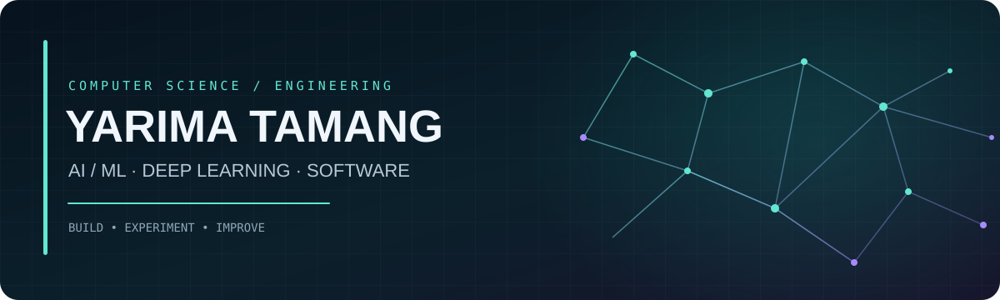

<!--
  Yarima Tamang | Computer Science • AI/ML • Software Engineering
  A custom, evidence-first GitHub profile README.
-->

 

### Computer Science Engineer in progress · AI/ML · Deep Learning · Full-Stack Development

*I like understanding how things work, building useful systems, and improving them through experimentation.*

---

## `01 / About me`

Hey, I'm **Yarima Tamang** — a Computer Science and Engineering student interested in the intersection of **machine learning, deep learning, software engineering, and practical product development**.

I want my projects to demonstrate more than a list of frameworks: the problem, the decisions behind the implementation, how results are evaluated, and what I would improve next.

- 🧠 **AI & Machine Learning** — learning, experimenting with models, and comparing approaches with meaningful evaluation.
- 🔬 **Deep Learning** — exploring neural-network architectures, training workflows, and responsible interpretation of results.
- 🧩 **Computer Science** — programming fundamentals, data structures, algorithms, and computational problem-solving.
- 🛠️ **Software Engineering** — readable code, APIs, data handling, testing, and maintainable project structure.
- 🌐 **Full-stack development** — connecting usable interfaces with application logic and data services.

> My goal: build things that are useful, explain them clearly, and make the engineering behind them easy to inspect.

## `02 / Featured projects`

<table>
  <tr>
    <td width="50%" valign="top">
      <h3>🛒 GrocerEase</h3>
      
A grocery-shopping web application featuring product discovery, cart workflows, browser state, external product data, and admin-facing screens.

      
<strong>Implementation areas</strong> React · JavaScript · Tailwind CSS · Axios · Node.js · JSON Server

      <a href="https://github.com/YarimaTamang/GrocerEase">Explore repository →</a>
    </td>
    <td width="50%" valign="top">
      <h3>🎓 MSC-hack</h3>
      
A university-events platform project with event listings and event-management workflows. Its README describes additional AI and email-processing ideas that should be distinguished from features verified in code.

      
<strong>Implementation areas</strong> JavaScript · Express · EJS · MongoDB · Mongoose

      <a href="https://github.com/YarimaTamang/MSC-hack">Explore repository →</a>
    </td>
  </tr>
  <tr>
    <td width="50%" valign="top">
      <h3>🧪 MscProject</h3>
      
An event-platform codebase that currently overlaps with MSC-hack. I plan to clarify its distinct purpose and documentation before presenting it as a separate flagship project.

      <a href="https://github.com/YarimaTamang/MscProject">Explore repository →</a>
    </td>
    <td width="50%" valign="top">
      <h3>🧠 ML & Deep Learning Lab</h3>
      
This space is reserved for documented model experiments, reproducible comparisons, evaluation metrics, and clear explanations of findings as verified implementations are published.

      <a href="https://github.com/YarimaTamang?tab=repositories">Explore all repositories →</a>
    </td>
  </tr>
</table>

## `03 / Technical interests`

<strong>AI, machine learning & deep learning</strong>

 

  
  
  
  

<em>Specific libraries, model architectures, and benchmark results will be listed alongside code or reports that demonstrate them.</em>

<strong>Programming & computer science</strong>

 

  
  
  
  
  

<strong>Frontend & user experience</strong>

 

  
  
  
  

<strong>Backend, databases & APIs</strong>

 

  
  
  
  
  

## `04 / How I approach engineering`

- **Understand the problem** before choosing a tool or model.
- **Build in small steps** and keep the code understandable.
- **Measure outcomes** using appropriate tests and evaluation metrics.
- **Document trade-offs** and limitations instead of hiding them.
- **Improve iteratively** based on evidence, feedback, and experiments.

## `05 / GitHub activity`

  
  

  

## `06 / Connect`

  
  

Stay curious. Build carefully. Measure honestly. Keep improving.

